  

<b>Hi, I'm Eesha 👋</b>

CS master's student at **UIUC** working on data pipelines, dashboards, and LLM systems. Looking for **data science and analytics** roles.

🌐 [Portfolio](https://eesharizwan.github.io) &nbsp;|&nbsp; 💼 [LinkedIn](http://www.linkedin.com/in/eesha-rizwan-218888336) &nbsp;|&nbsp; 📫 [erizwan915@gmail.com](mailto:erizwan915@gmail.com)

### Right now

- 📊 **Data Steward** at the Education Justice Project, building Tableau dashboards and moving EJP's LLM chatbot onto university-hosted open models
- 🖥️ **Graduate Developer, Research Enablement** in UIUC's Office of the CIO, building data tools used across campus and a chatbot for the Research Enablement website
- 🎓 MS in Computer Science at UIUC (expected 2028), BA in Data Science from Knox College

### Featured projects

| Project | What it does | Built with |
|---|---|---|
| [Fraud & anomaly detection dashboard](https://github.com/eesharizwan/fraud-detection-dashboard) | Flags suspicious transactions and explains each flag with SHAP | XGBoost, LSTM Autoencoders, Streamlit |
| [Pharmacy analytics dashboard](https://github.com/eesharizwan/pharmacy-dashboard) | Financial analytics and forecasting on 50 months of real P&L data ([Tableau dashboard](https://public.tableau.com/app/profile/eesha.rizwan/viz/PLPerformanceDashboard_17883815524110/PLPerformanceDashboard)) | React, FastAPI, pandas, Tableau |
| [Zoom attendance dashboards](https://github.com/Research-Enablement/zoom-attendance-web) | In-browser tool that turns Zoom exports into attendance dashboards, used at UIUC ([live app](https://research-enablement.github.io/zoom-attendance-web/)) | Python, Pyodide, pandas, HTML |
| [Knox CTL tutoring chatbot](https://github.com/eesharizwan/knox-ctl-chatbot) | Local RAG chatbot for tutoring schedules and booking | Llama 3.2, FAISS, FastAPI, Ollama |
| [Hadoop and Spark cluster](https://github.com/eesharizwan/CS511-MP1) | Dockerized multi-node HDFS and Spark cluster (I built the Spark half) | Spark, HDFS, Docker |
| [PageRank at scale](https://github.com/eesharizwan/CS511MP2) | Distributed PageRank running on the CS 511 cluster | Spark, Hadoop |

### Tools I use

### Contributions

<picture>
  <source media="(prefers-color-scheme: dark)" srcset="https://raw.githubusercontent.com/eesharizwan/eesharizwan/output/pacman-contribution-graph-dark.svg">
  <source media="(prefers-color-scheme: light)" srcset="https://raw.githubusercontent.com/eesharizwan/eesharizwan/output/pacman-contribution-graph.svg">
  
</picture>
